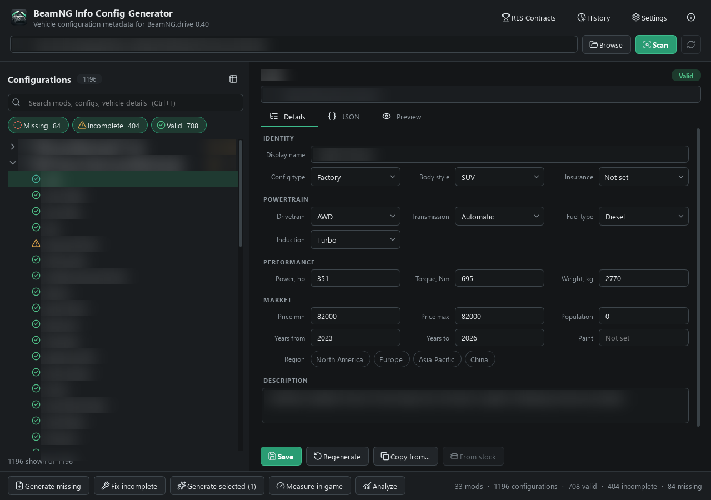
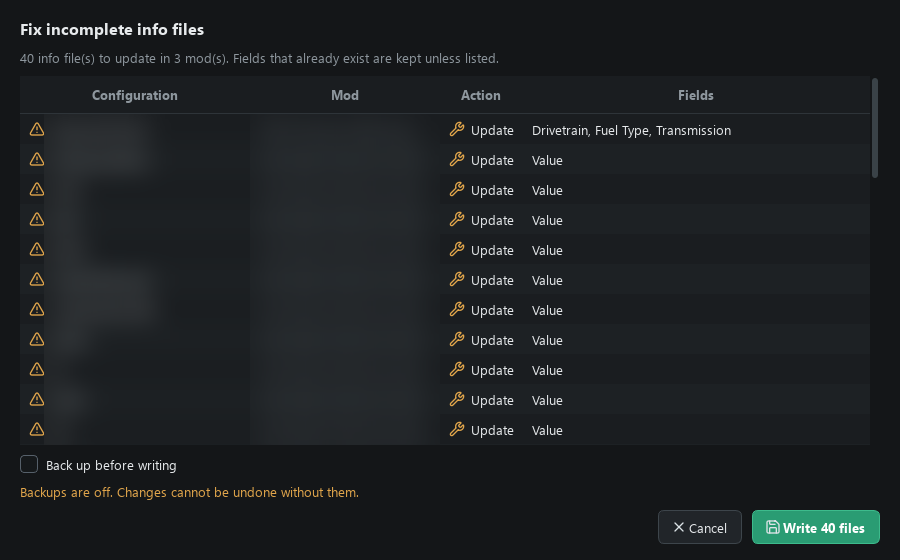
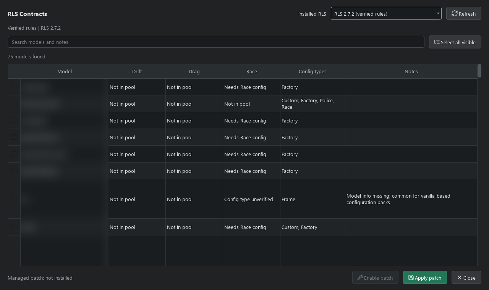
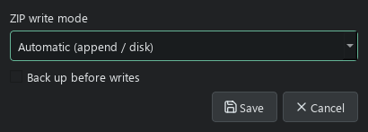

# BeamNG Info Config Generator

Create, edit, and repair `info_*.json` files for **BeamNG.drive vehicle configurations**, directly in ZIP mods or extracted folders.

[Releases](https://github.com/Holorigg/beamng-info-config-generator/releases) · [Report a bug](https://github.com/Holorigg/beamng-info-config-generator/issues) · [Changelog](CHANGELOG.md)

## Download

**Windows x64. No Python installation required.**

| Version | Download | How to run |
| --- | --- | --- |
| Single EXE | [beamng-infogen.exe](https://github.com/Holorigg/beamng-info-config-generator/releases/latest/download/beamng-infogen.exe) | Download and launch. Settings are saved in your user folder. |
| Portable ZIP | [beamng-infogen-portable.zip](https://github.com/Holorigg/beamng-info-config-generator/releases/latest/download/beamng-infogen-portable.zip) | Extract the whole folder, then launch the EXE inside. Settings and logs stay in its `data` folder. |

Neither version needs an installer. Keep the portable folder together, including `_internal`; do not run it from inside the ZIP. Checksums are included in [SHA256SUMS.txt](https://github.com/Holorigg/beamng-info-config-generator/releases/latest/download/SHA256SUMS.txt).

## The Editor

A real mod library. Mod and configuration names, descriptions, and local paths are blurred for privacy.

- **Find missing info files.** Scan a mods directory, search configurations, and filter by Missing, Incomplete, or Valid. Problem counts are shown per mod.
- **Edit one config or process a batch.** Use the form, edit the full JSON, or generate metadata for a selection. The form follows BeamNG 0.40 values and includes insurance class, years, region, population, and paint.
- **Use stock vehicle data.** For mods based on a stock model, **From stock** fills typical price, power, torque, weight, years, and more from your game files. Generation can use the same data.
- **Measure in game.** Start BeamNG with a temporary user folder and read real power, torque, weight, drivetrain, transmission, fuel, and induction of the selected configurations. Review the values before they are written.
- **Preview bulk writes.** Generate and Fix show every file and changed field before writing, with an option to limit them to what search and filters show.
- **Keep existing metadata.** Ordinary saves retain fields the form does not edit, such as years, paints, and custom properties.
- **Work with archives directly.** New info files can be appended without extracting the mod. Replacements are grouped by archive.
- **See what happened.** Operations have progress, cancellation, and a history of completed writes and errors.
- **RLS Contracts support.** Quickly check Drift, Drag, and Race eligibility and add selected vehicle models to the contract pool with a separate addon you can enable or disable. Works with RLS 2.7 and 2.8.
- **English or Russian interface.** Choose the language in Settings.

ZIP mods, extracted mods, and the usual `repo` and `unpacked` folders are supported. You can also open a single extracted mod folder.

## Quick Start

1. Click **Scan detected folder**, or **Browse** and select your BeamNG mods directory. The game's launcher can help locate your current user folder.
2. Click **Scan**, then select a configuration to inspect its info file.
3. Enable backups in **Settings** or in the bulk preview before making bulk changes.
4. Use **Generate missing** for absent files, **Fix incomplete** for invalid required fields, or edit a configuration and click **Save**.

Bulk actions open a preview first. By default they cover all loaded configurations; choose **Only those shown by search and filters** to narrow them, or use **Generate selected** for your selection.

The game installation is found through Steam. If it is not found, choose the BeamNG.drive folder in **Settings** or when you first click **From stock**. Stock data is only read.

`Ctrl+S` saves the active draft. `F5` rescans. Unsaved edits prompt you before switching configurations, rescanning, or closing.

## RLS Contracts

Open **RLS Contracts** after scanning your mods. The table groups configurations by vehicle model and shows pool membership, config-type restrictions, blacklists, and uncertain metadata. Select the models you want and click **Apply patch**. Diagnosis reads small metadata files directly from archives; applying the patch writes a small addon instead of rebuilding RLS or your vehicle ZIPs.

The addon is `infogen_rls_contracts.zip` in the selected mods folder. **Disable patch** switches it off without changing the RLS archive, vehicle mods, or career save. Updating or disabling an existing addon first creates a dated backup. Restart BeamNG after applying, updating, or disabling it.

**Checked against RLS Career Overhaul 2.7.2 and 2.8.0 (BeamNG 0.40):** file inspection and isolated Lua 5.1 tests using each version's actual contract-selection code, including stock BeamNG 0.40 metadata. RLS 2.8.0 was checked from its public source tag, not from the Patreon alpha package. **Not tested in-game.** Other versions are allowed after a warning, not blocked by their version number.

Adding a model does not force an immediate offer. RLS still controls randomness, unlocks, blacklists, and eligibility. In 2.7.2 and 2.8.0, random Race contracts require at least one configuration with `"Config Type": "Race"`; Drift and Drag do not have that restriction by default. Owned vehicles follow separate RLS rules. The tool does not inspect ownership or your active career state, and it does not relabel street configurations as race cars.

See [RLS compatibility, limitations, and verification](docs/RLS_CONTRACTS.md) for details.

## ZIP Write Modes

| Mode | What it does |
| --- | --- |
| **Automatic** (default) | Appends new files. Rebuilds on disk when replacing existing files. |
| **Disk** | Streams a rebuilt archive through a temporary file, keeping memory use bounded. |
| **RAM** | Holds the rebuilt compressed archive in memory, then commits it through a temporary file. |

Disk and RAM rebuilds need free disk space beside the mod. RAM mode is optional and is not necessarily faster. Backups are dated `.bak` copies; backing up a ZIP needs space for the entire original archive.

Cancelling stops later work but does not undo completed archives. Append rollback handles caught write errors, not power loss or a forcibly killed process. See [file handling and safety](docs/USAGE.md#file-handling-and-safety) for details.

## A Few Things To Know

**Does it measure horsepower or performance?** **Measure in game** reads power, torque, peak RPM, weight, and powertrain type from the vehicle in BeamNG itself, like the game's stock info files. Acceleration, top speed, and braking times are not measured. Without it, part-name detection is heuristic, and **From stock** is a starting point taken from the stock model.

**Will it fix RLS Career Overhaul listings?** It can create or repair vehicle metadata used by career mods. The separate RLS Contracts addon extends the contract model pool, not dealership listings. A Valid status only means the metadata passed this tool's checks; dealer filters, game state, and mod compatibility still matter.

**Does saving preserve my JSON exactly?** Extra fields are retained, but saves use standard JSON. Comments and original formatting are not preserved. **Regenerate** deliberately replaces the full info document after confirmation.

## Documentation

- [Usage, file formats, and safety](docs/USAGE.md)
- [Run from source, tests, and Windows builds](docs/DEVELOPMENT.md)
- [Implementation references](docs/RESEARCH.md)

Created by **Holorigg**. [MIT License](LICENSE). Interface icons: [Lucide / Feather](icons/lucide/SOURCE.md).

Independent project, not affiliated with BeamNG.
